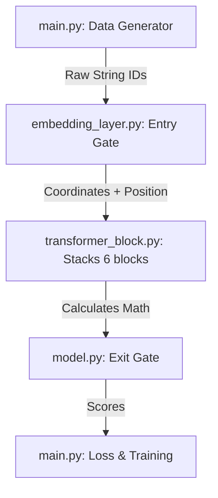

# Transformer Arithmetic: Basic Overview Guide

This guide provides a high-level conceptual explanation of how our toy Transformer learns to solve simple addition (e.g. predicting `168` from the input `123+45=`).

---

## 1. The Assembly Line (Our Files)

Think of our transformer codebase as an automated factory assembly line. Here is the role of each worker (file):



1. **[main.py](../main.py) (The Generator & Grader):**
   Generates random math equations (our training data), grades the model's guesses (calculates loss), and updates the parameters.
2. **[embedding_layer.py](../embedding_layer.py) (The Entry Gate):**
   Translates raw characters into a continuous coordinates map and adds position markers so the model knows sequence order.
3. **[attention.py](../attention.py) (The Collaborator):**
   Allows tokens to look back at other tokens in the history to find relationships (e.g. the `=` sign looking back at digits).
4. **[transformer_block.py](../transformer_block.py) (The Workstation):**
   Groups the Attention mechanism and the MLP (individual token calculator) into a single repeatable block.
5. **[model.py](../model.py) (The Exit Gate):**
   Stacks 6 processing blocks sequentially and translates the final coordinates back into readable character scores (logits).

---

## 2. Vocabulary Selection & Special Tokens

Our vocabulary consists of exactly **14 distinct tokens**. This is the absolute minimum required set of symbols to represent 3-digit addition problems.

```text
Vocabulary Index Map:
0  -> '<pad>'  (Padding spacer)
1  -> '0'
2  -> '1'
3  -> '2'
4  -> '3'
5  -> '4'
6  -> '5'
7  -> '6'
8  -> '7'
9  -> '8'
10 -> '9'
11 -> '+'
12 -> '='
13 -> '<eos>'  (End-of-sequence marker)
```

### Why Character-Level instead of Word-Level?
For math, word-level tokenization is useless. If the model saw the number `"168"` as a single token, it would have to learn `"168"` as a completely separate symbol from `"169"`. It wouldn't know they share digits! 
By using **character-level tokenization**, the model inspects individual digits one-by-one. This allows it to learn the columns-based rules of addition (units place, tens place, hundreds place, carrying) just like a human.

### The Role of `<pad>` (Index 0)
JAX compiles our GPU code for **fixed-size arrays** (length 16). Since equations have different lengths (e.g., `1+1=2` is 5 chars, while `999+999=1998` is 12 chars), we fill the remaining empty slots with the `<pad>` character. 
* This keeps the container size exactly 16, preventing the JAX compiler from constantly pausing to recompile GPU code for different sequence lengths.

### The Role of `<eos>` (Index 13)
The `<eos>` (End-of-Sequence) token acts as a **mathematical stop sign**. 
* During generation, the model predicts characters one-by-one. 
* When the model outputs `<eos>` (meaning "I am finished writing the answer"), the autoregressive loop detects it and immediately stops the generation.

---

## 3. Conceptual Pillars of the Transformer

### 1. Embeddings: Moving Symbols to Map Coordinates
We map every character in our vocabulary to a unique row of **128 float coordinates**.
* **Identity:** *"What am I?"* (e.g. `[+0.5, -0.1, ...]` represents a digit).
* **Position:** *"Where am I in time?"* (e.g. `[+0.0, +0.02, ...]` represents being at index 3).
* We add these together. This gives every character a unique position-aware location.

### 2. Attention: The Search Engine
When the model is trying to predict what comes after `123+45=`, it needs to query its history. It uses three vectors:
* **Query (Q):** *"What am I searching for?"*
* **Key (K):** *"What information do I contain?"*
* **Value (V):** *"What is my actual content?"*

The model compares **Queries** with **Keys** to find matches, and then pulls the corresponding **Values**.

### 3. Causal Masking: No Cheating!
Looking ahead is blocked. The causal mask ensures the model only predicts the next step using past history.

### 4. JIT Compilation & Hardware Acceleration
JAX's compiler (`jax.jit`) compiles our entire training step into a single binary kernel that runs directly on the GPU cores.
> [!WARNING]
> Because JAX does not officially support native Windows GPU drivers, **Windows users must run the code inside WSL2 (Ubuntu)** to enable GPU/CUDA training. Running natively on Windows defaults to CPU-only execution, which is significantly slower.

